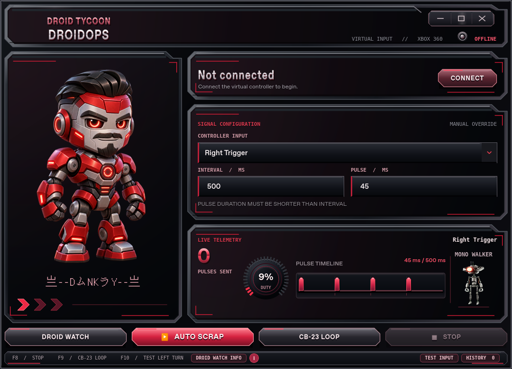
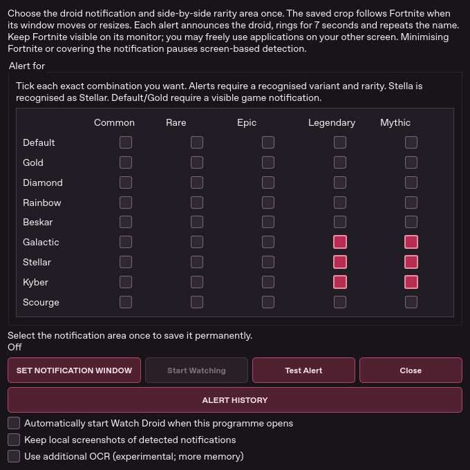

# Danksy DroidOps

DroidOps is my Windows companion app for Droid Tycoon. It brings Droid Watch, Auto Scrap and the CB-23 mission loop into one compact desktop window.

**Current version: 1.0.54 · Windows testing release · MIT open source**

## Download and install

Open this repository's **Releases** section and download **Danksy_DroidOps_1.0.54_Windows_Setup.exe** from the release assets. Run it, follow Setup, and restart Windows if prompted. Then open DroidOps from the desktop or Start menu.

Setup includes its own Python runtime, application libraries, OCR models, voices, alarms and artwork. It installs the bundled ViGEmBus virtual Xbox controller driver if it is missing. You do not need to install Python, run a BAT file or download dependencies separately to use the installed app.

GitHub's **Source code** downloads are for the source project. Choose the **Windows_Setup.exe** asset to install the program. The installer will appear in Releases after I publish it.

**Requirements:** an Intel/AMD 64-bit Windows 10 or Windows 11 PC, administrator access for Setup, and enough usable screen space for the fixed 1080 × 780 window at your Windows display scaling. Windows on ARM, macOS and Linux are not supported app targets. The watcher needs the game's notification area to remain visible.

## What it does

- **Droid Watch:** watch a selected Sandcrawler notification area and announce the exact variant and rarity you have ticked.
- **Auto Scrap:** repeat a selected controller input with saved interval and pulse settings.
- **CB-23 Loop:** run the saved mission sequence, with adjustable camera timing and a separate left-turn test.
- **Session history:** see the alerts detected since opening the app.
- **Compact interface:** a fixed window, personalised droid artwork and clear access to the main controls.

## Droid Watch

Open **Droid Watch**, set the notification window and tick the combinations you want. Keep the complete notification visible, including the variant and rarity beside the droid name. The saved selection follows the Fortnite window.

| Variants | Rarities |
|---|---|
| Default, Gold, Diamond, Rainbow, Beskar, Galactic, Stellar, Kyber, Scourge | Common, Rare, Epic, Legendary, Mythic |

There are 45 selectable combinations. **Stella** is accepted as **Stellar**. Default and Gold need a notification that the game actually displays. An alert speaks the recognised name, plays the original seven-second alarm, then repeats the name once. There are no generic “Possible Mythic” or “Possible Legendary” announcements.

The game can be out of focus, but its watched area must remain visible. Minimising or covering it pauses screen-based monitoring. Recognition can miss unclear, obscured or very brief text. Additional OCR is experimental and off by default; see [privacy](PRIVACY.md) before enabling it.

## Controls

| Control | Action |
|---|---|
| Connect | Create the virtual Xbox controller |
| Droid Watch | Open the notification area and alert settings |
| Auto Scrap | Start repeated controller input |
| CB-23 Loop | Open mission settings and calibration |
| Test Input | Send one pulse using the selected input |
| F8 / Stop | Stop controller automation |
| F9 | Start the saved CB-23 loop |
| F10 | Test the saved left turn |
| History | Open the current session's alert history |

Stop controller automation before editing interval or pulse. Click the number, type a value and press Enter. Pulse must be shorter than interval. Drag the header to move the main window; its size stays fixed.

For a left-turn test, return to Fortnite, close the menus and stop moving the mouse. The test waits for the game to remain active for one second. If buttons work but the camera does not, check **Settings → Mouse and Keyboard → Lock Input Method as Mouse → Off** and try again. Windows stick confirmation means Windows received the axis; check the camera movement yourself before running a mission loop.

## Testing status

This is a testing release. The source tests, rendered interface checks and installer archive checks have passed locally. The prepared GitHub workflow still needs its first run. Windows installation, live screen capture and Fortnite camera response need checking on an actual Windows PC. [Checks and limits](docs/REVIEW.md).

A full-PC restart has been reported on one machine and its cause is unresolved. If that happens, leave Droid Watch off on that PC and use the included read-only diagnostic collector. [Restart checks](docs/RESTART_DIAGNOSTICS.md).

The screenshots show the actual Qt interface rendered on Linux, with no controller or game session running. Fonts and dialog frames can differ on Windows.

## Help and source

- [Installation and user guide](docs/USER_GUIDE.md)
- [Troubleshooting](docs/TROUBLESHOOTING.md)
- [Version 1.0.54 release notes](docs/RELEASE_NOTES_1.0.54.md)
- [Upload this project to GitHub](docs/GITHUB_UPLOAD.md)
- [Build from source](docs/MAINTAINING.md)
- [Changelog](CHANGELOG.md) · [Privacy](PRIVACY.md) · [Third-party credits](THIRD_PARTY_NOTICES.md)

For a bug, open an issue with the version, Windows version, what you were doing and the exact error. Check logs and screenshots for personal details before posting them.

## Licence

I have kept DroidOps open source under the [MIT licence](LICENSE), copyright Danksy. You can use, change and redistribute the code with the licence and copyright notice retained. Contributions go through pull requests; public source does not give anyone permission to push changes into my repository.

The included libraries, fonts, models and controller driver keep their own licences. This is an independent project, unaffiliated with Epic Games, Lucasfilm or the creators of Droid Tycoon. Follow the rules of the game and platform you use it with.
